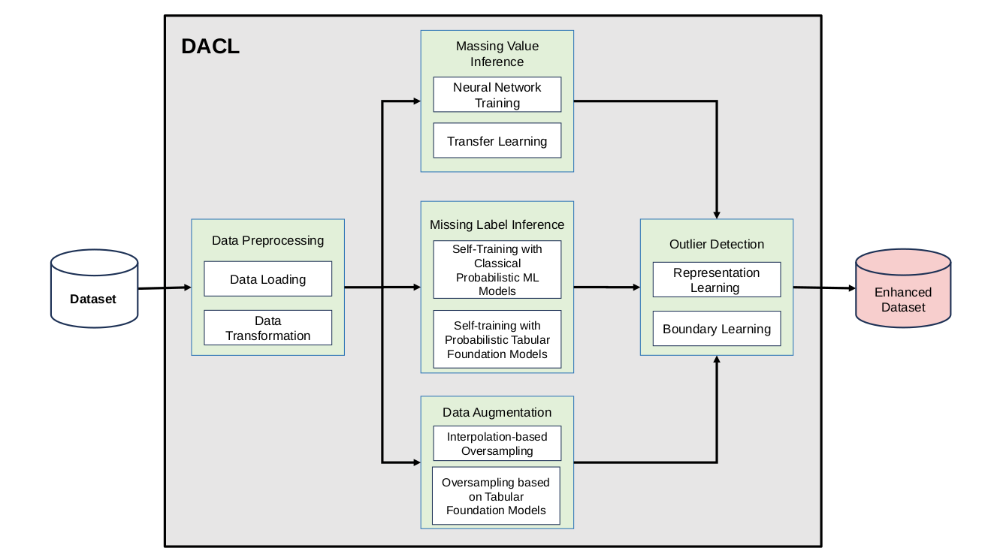

# DACL
> PANDORA DACL component



Installation / creating conda environment
```sh
conda env create -f environment.yml
conda activate dacl_env
pip install -r requirements.txt
```

> DACL Command-Line Arguments

| Argument | Description |
| :--- | :--- |
| `--input <path>` | path to the input (incomplete) dataset |
| `--output <path>` | path to the output (complete) dataset that will be created |
| `--info` | boolean flag, when present DACL gives information about the input dataset (the number of features and data points) |
| `--mvi_info` | boolean flag, when present DACL gives information about missing values detected in the input dataset (for real-valued features/columns) |
| `--mli_info` | boolean flag, when present DACL gives information about missing labels detected in the input dataset (for features/columns containing discrete values) |
| `--outlier_info` | boolean flag, when present DACL gives information about outliers detected in the input dataset |
| `--gt <path>` | path to the ground-truth dataset used when evaluating DACL MVI, MLI and DAUG functionalities |
| `--algorithm <name>` | indicates MVI, MLI or DAUG algorithm that will be applied to the input dataset to create the output dataset |
| `--target_var <name>` | indicates target variable (class) in the input dataset for MLI and DAUG functionalities |
| `--ignore_cols <names>` | columns (features) that will be ignored when applying DACL, given as a string with columns names separated by commas |
| `--apply_mvi` | boolean flag, when present DACL executes missing value inference |
| `--apply_mli` | boolean flag, when present DACL executes missing label inference |
| `--apply_daug` | boolean flag, when present DACL executes data augmentation |
| `--mvi_eval` | boolean flag, when present DACL executes primary evaluation of missing value inference on the input file considering the ground-truth dataset |
| `--mvi_app_eval` | boolean flag, when present DACL executes applicative evaluation of missing value inference on the input file |
| `--mli_eval` | boolean flag, when present DACL executes primary evaluation of missing label inference on the input file considering the ground-truth dataset |
| `--mli_app_eval` | boolean flag, when present DACL executes applicative evaluation of missing label inference on the input file |
| `--daug_eval` | boolean flag, when present DACL executes evaluation of data augmentation on the input file (augmented dataset) considering the ground-truth dataset (non-augmented dataset) |

> Source code tree
```text
code/
├── cl_eval.py
├── dacl.py
├── datatable.py
├── daug
│   ├── daug.py
│   ├── daug_impl.py
│   └── tabpfgen_local.py
├── exec_daug.py
├── exec_mli.py
├── exec_mvi.py
├── mli
│   └── mli.py
├── mvi
│   ├── imputer.py
│   ├── mvi_statistic.py
│   ├── mvinn.py
│   ├── mvinn_sw.py
│   ├── odeval.py
│   ├── regeval.py
│   └── zeroimputer.py
├── reproducibility.py
└── utils
    └── thr_anom_labeler.py
```

> Python modules and packages:
* dacl.py -- main entry point for DACL
* exec_mvi -- module for executing DACL MVI (missing value inference)
* exec_mli -- module for executing DACL MLI (missing label inference)
* exec_daug -- module for executing DACL DAUG (data augmentation)
* datatable -- module implementing DACL internal data representations
* reproducibility -- module ensuring reproducibility of all DACL experiments and evaluations
* cl_eval -- module implementing classification evaluation for DACL MLI and DAUG
* mvi -- package implementing DACL MVI algorithms
* mli -- package implementing DACL MLI algorithms
* daug -- package implementing DACL DAUG algorithms
* utils -- package providing utilities


  
